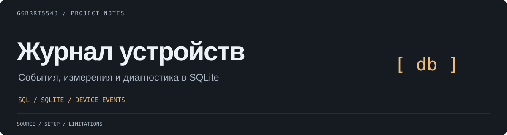

# Журнал событий устройства

## Назначение системы
База данных хранит события, которые сообщают интеллектуальные устройства (термостаты и датчики), установленные в разных помещениях: включение, выключение, показания датчиков и ошибки. Запросы из `queries.sql` помогают следить за работой устройств и находить неисправные.

## Структура таблиц

| Таблица | Столбцы |
|---------|---------|
| devices | device_id (PK), name, location |
| events  | event_id (PK), device_id (FK → devices), event_time, event_type, value |

- `event_type` — одно из значений: 'включение', 'выключение', 'показание', 'ошибка'.
- `value` — заполняется только для событий типа 'показание' (например, температура), для остальных — NULL.

## Файлы проекта
- `schema.sql` — создание таблиц
- `data.sql` — тестовые данные
- `queries.sql` — запросы для мониторинга и диагностики

## Порядок разворачивания базы данных с нуля
```
sqlite3 shop_devices.db < schema.sql
sqlite3 shop_devices.db < data.sql
sqlite3 -header -column shop_devices.db < queries.sql
```
Файлы выполняются строго в этом порядке: сначала схема, затем данные, затем запросы. Файл базы данных `*.db` в репозиторий не попадает (указан в `.gitignore`).

## Вывод по диагностике
Чаще всего об ошибках сообщает «Термостат-02» в офисе 102: за один день он трижды сообщил о неисправности, тогда как другие устройства — не больше одного раза. Его стоит проверить в первую очередь. «Датчик-03» в серверной работает без сбоев, а «Термостат-01» сообщил об одной ошибке, поэтому за ним достаточно просто понаблюдать.


---

Maintained by [ggrrrt5543](https://github.com/ggrrrt5543). Инструкции, ограничения и сведения о сторонних компонентах приведены выше.
